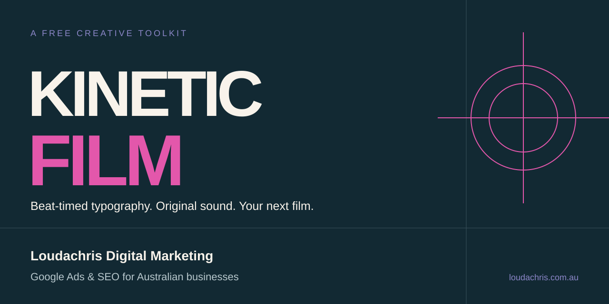
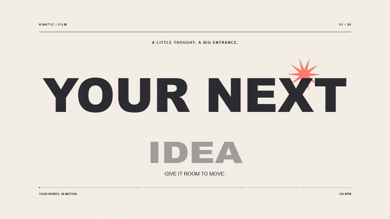

# Kinetic Film



Turn a short brief into a beat-timed typography film, with an editable spec, an original electronic soundtrack and a local MP4 render.

Free to use, adapt and share under the [MIT licence](LICENSE).

From [Loudachris Digital Marketing](https://www.loudachris.com.au/?utm_source=github&utm_medium=referral&utm_campaign=kinetic_film).

I help Australian businesses get found on Google through SEO and Google Ads, with the work handled personally from Adelaide.

[Google Ads management](https://www.loudachris.com.au/google-ads?utm_source=github&utm_medium=referral&utm_campaign=kinetic_film) · [SEO services](https://www.loudachris.com.au/seo?utm_source=github&utm_medium=referral&utm_campaign=kinetic_film) · [Claim a FREE Google Ads audit](https://www.loudachris.com.au/google-ads/account-review?utm_source=github&utm_medium=referral&utm_campaign=kinetic_film)

## See the style



The animated preview is silent; the local render includes synthesised music and scene accents.

## What you get

- 6 scene styles: punch, stacked type, elastic lettering, orbit, steps and an end card.
- Landscape, portrait and square compositions.
- Beat-based timing, repeatable frames and an editable JSON spec.
- A local electronic soundtrack made from oscillators and seeded noise.
- Browser preview, still-frame capture, H.264 export and a technical check report.
- A reusable [SKILL.md](SKILL.md) and [full production guide](docs/guide.md).

This independent edition is a text-led canvas renderer with system fonts.

It doesn't include 3D scenes, footage editing, a hosted editor or a cloud generation service.

## Try it

Install [Node.js](https://nodejs.org/) 22 or later, [Git](https://git-scm.com/downloads), and [FFmpeg](https://ffmpeg.org/download.html), including FFprobe, on your PATH.

Then run:

```sh
git clone https://github.com/loudachris/kinetic-film.git
cd kinetic-film
npm ci --ignore-scripts
npx playwright install chromium
npm run film -- doctor
npm run film -- preview examples/demo.json
```

Open the local address printed by the preview command, then use Ctrl+C to stop it.

The preview is silent; render the MP4 to hear its soundtrack.

In Windows PowerShell, use `npm.cmd` and `npx.cmd` if your execution policy blocks the `.ps1` wrappers.

On Linux, Chromium may also require the [documented Playwright system dependencies](https://playwright.dev/docs/browsers#install-system-dependencies).

Render and check the included 20-second demo:

```sh
npm run film -- render examples/demo.json --out output/demo.mp4
npm run film -- check output/demo.mp4
```

Open `output/demo.mp4` to watch the result with sound.

## Use the skill

Open the cloned repository in a coding agent with local file and terminal access, then paste:

```text
Read SKILL.md in this repository and use it to make a 20-second
portrait launch film for my product.

Product: a reusable notebook for daily planning.
Audience: people who like a clear plan for the day.
Message: plan your next move.
Exact CTA: Explore the notebook.
Colours: dark navy, warm white and coral.
Sound: original electronic beat and timed effects.

Create the brief, beat sheet and editable spec.
Render a draft, inspect the scenes, then deliver a checked 1080x1920
MP4 with the reproduction command and technical check report.
```

Replace the example with your own product and claims.

The repository itself is the skill folder; if your tool supports local skills, register this folder using that tool's installation instructions.

Keep the complete folder together because the skill calls its bundled scripts and references.

A chat without local tools can prepare the brief and spec, but rendering needs a machine with the prerequisites above.

## Make your own manually

```sh
npm run film -- init films/my-film --format portrait
```

Edit `films/my-film/spec.json`, then run:

```sh
npm run film -- preview films/my-film/spec.json
npm run film -- render films/my-film/spec.json --out output/my-film.mp4
npm run film -- check output/my-film.mp4
```

The [spec reference](docs/spec.md) explains every field, and the [guide](docs/guide.md) covers timing, draft renders, sound and quality checks.

## Privacy and reuse

Previewing and rendering run on your machine without an account, API key or telemetry.

Setup downloads dependencies and a browser; the website links open only when you choose to visit them.

The link parameters identify this repository as the referral source and don't contain user identifiers.

The example is fictitious, and the package contains no client work or account data.

Your generated films have no Loudachris watermark or mandatory promotional end card.

Review your own wording and assets before sharing a film or committing a project.

See [dependency notices](THIRD_PARTY.md), [tested capabilities](docs/verification.md) and [safe contribution guidance](CONTRIBUTING.md).

## Help with Google Ads or SEO

I manage Google Ads and SEO personally for businesses across Australia.

If you're already running Google Ads, [claim a FREE Google Ads audit](https://www.loudachris.com.au/google-ads/account-review?utm_source=github&utm_medium=referral&utm_campaign=kinetic_film).

For organic search, [explore my SEO services](https://www.loudachris.com.au/seo?utm_source=github&utm_medium=referral&utm_campaign=kinetic_film).
